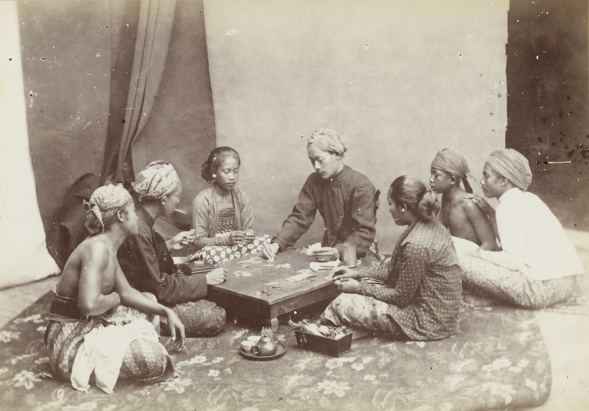

Koa (also Kowah) is a draw-and-discard game played with [Ceki cards](articles/cards/ceki/ceki.md). It is also sometimes simply called Ceki,[@CekiOrKowah] and is probably the most canonical of the games played with the cards.

> [!figure]
>
> 
>
> ```yaml
> license: "cc0"
> size: "wide"
> originalUrl: "http://hdl.handle.net/10934/RM0001.COLLECT.258935"
> identifier: "RP-F-F18040"
> orgName: "Rijksmuseum"
> ```
>
> A Koa game in progress, 1890s or earlier.[^fn0] Note the <span lang="jv-Latn">[tong](articles/glossary.md#tong)</span> on the table for collecting the house cut.

[^fn0]: Identified as such in @VolkenDerAarde [p. 106], and @BlikJavaansche_2 [pl. XV].

Check also @CliffordMalay3 [335]?

See name of a card, @MinangkabauschMaleischNederlandsch [325] (under Gapi). Also search "Koaspel" in the same book.

## Play

As described in @CliffordMalay3 [335]. Deal 5 cards to each, then 4 to leader and 3 to others. Leader discards, next may take it or turn a card up from the centre.

Goal to get two sets of three, then a pair of identical cards with which to match a third. When they are in this state they call ‘<span lang="ms">tan</span>’ (<span lang="ms-Arab">تان</span>, from Hokkien <span lang="nan">等</span> <span lang="nan-Latn-pehoeji">tán</span>, ‘wait’).

Winning in this manner is called <span lang="ms">kincang</span>[^kincang] (probably from Thai <span lang="th">กินช่อง</span> <span lang="th-Latn">kin chong</span>, ‘eat the gap’).[^thai] They win the stakes and the pool; double stakes for 2 tongs and treble stakes for 3 tongs.

[^kincang]: Older orthography <span lang="ms">kînchang</span> (<span lang="ms-Arab">كينچڠ</span>).

[^thai]: See same usage in [Pai Tong](games/pai-tong/pai-tong.md).

Another manner is called <span lang="ms">pancing</span>[^pancing] (‘fishing’) where the player has two sets of three and a pair of different cards, awaiting the third. This wins stakes but not pool.

[^pancing]: Older orthography <span lang="ms">pânching</span> (<span lang="ms-Arab">ڤانچڠ</span>).

The final manner is <span lang="ms">tan dûa lâwang</span> (<span lang="ms-Arab">تان دوا لاوڠ</span>, ‘two door tan’) where the player has one set of three, and five cards of the same rank: two pairs and a single card. This wins as either a <span lang="ms">kînchang</span> or <span lang="ms">pancing</span> depending on what final card is collected.
