# <span lang="th">ไพ่ตอง</span> · <span lang="th-Latn" class="noun">Pai Tong</span>

<span class="noun aka" lang="th-Latn">Pai Tong</span> (<span lang="th" class="aka">ไพ่ตอง</span>, ‘<span lang="th-Latn">tong</span> cards’) is a draw-and-discard card game from Thailand, played with Thai money cards. It is also known as <span class="noun aka" lang="th-Latn">Pai Phong (Thai)</span> (<span lang="th" class="aka">ไพ่ผ่อง(ไทย)</span>) or <span class="noun aka" lang="th-Latn">Pai Chot</span> (<span lang="th" class="aka">ไพ่จอด</span>).[@ThaiGambling 71–6] Very similar games are also played in Kelantan in Malaysia.

> [!aside]
>
> The name <span lang="th-Latn">pai phong</span> is probably derived from Hokkien <span lang="zh">碰牌</span> <span lang="nan-Latn">phòng pâi</span>, ‘bump cards’. This terminology is also used in the game of [Mahjong](games/mahjong/mahjong.md), where <span lang="zh">碰</span> — usually “pong” in English rules — is the call for claiming a tile to form a set of three identical tiles. For the derivation of <span lang="th-latn">tong</span>, see below.

> [!figure]
>
> 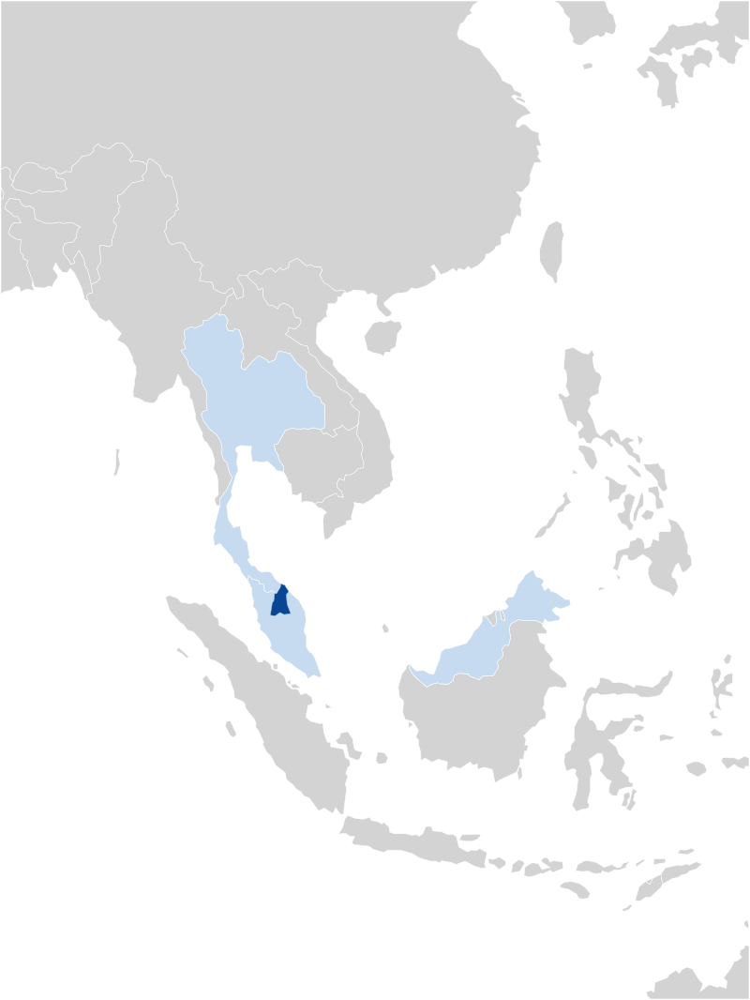
>
> Thailand and Malaysia, with Kelantan’s location highlighted.

## The basic game

### Equipment

The game is played by 4–7 people and uses two full sets of
money-suited cards (120 cards total, four copies of each card). Any style of card will work. If using the ‘prediction’ bets described below, each player also needs a separate set of their own containing one of each of the 30 card faces. If playing the ‘joker’ game described below, some decks apparently contain additional cards (which I have not seen anywhere); or else, existing cards from the deck are designated as jokers.

In Thailand playing cards are produced by government monopoly, so all decks are the same. Under the Gambling Act of 1935, the game may not be played for money without explicit permission.[@PaiPong]

> [!figure]
>
> 
>
> ```yaml
> noborder: true
> ```
>
> Thai-style government-printed money cards.


### Setup & Play

> [!aside]
>
> Videos of the game being played can be found on [TikTok](https://www.tiktok.com/@greathitz/video/6830362440400702722).

Shuffle the cards, and deal six cards to all players, then a second round of six cards to the starting player and five cards to all others, so that the starting player has 12 cards and the rest 11. Place the remainder of the cards face down in the middle to form the stock.

The first player starts the game by discarding any card face-up. Play proceeds with the next player in an anti-clockwise direction.

On a player’s turn they either take a card from the top of the stock, revealing it to all players before placing it in their hand, or they may take the card from the top of the discard pile (placed their by the previous player). Unless they have won the game by completing their hand, they must then discard a card to the discard pile.

The goal of the game is to form a complete hand which comprises four sets of three cards (12 total). Each set must consist of three cards of the same rank. A set of three identical cards of the same rank is called a **<span lang="th-Latn">tong</span>** (<span lang="th">ตอง</span>),[^fn0] and a set of three different cards is called a **head** (<span lang="th">เศียร</span> <span lang="th-Latn">siian</span>). A set of two identical cards and one other is called a **group** (<span lang="th">พวก</span> <span lang="th-Latn">phuak</span>). Heads and <span lang="th-Latn">tong</span>s are worth more in the scoring.

[^fn0]: This term — possibly derived from the Chinese <span lang="zh">同</span> (Hokkien: <span lang="nan-Latn-pehoeji">tông</span>; Teochew: <span lang="nan-Latn-pengim">tong⁵</span>; Mandarin: <span lang="cmn-Latn-pinyin">tóng</span>; Cantonese: <span lang="yue-Latn-jyutping">tung⁴</span>) ‘same; identical’ — is also used in other card games to describe a triplet, or a number with three identical digits.

The honour and ace cards are grouped into two sets; one set comprises the two red stamped cards and the 1 Myriads, and the other set is made up of the other three cards. Sources differ on whether or not these honour and ace cards can be combined to form a head; some rules allow this, others do not.[@PaiPhong1967 33–5][@ThaiGambling 72–5]

If a player draws and reveals a card that matches two identical cards in another player’s hand, that player may claim the card to complete a <span lang="th-Latn">tong</span> by calling “<span lang="th-Latn">phong</span>” (<span lang="th">ผ่อง</span>). The claiming player takes the card and must expose all cards forming the <span lang="th-Latn">tong</span> face-up on the table, then finishes their turn by discarding as usual. (This disrupts the normal order of play, and play continues from the player on their right.)

Finally, if a player only requires one card to win, they may take the turned-up card even if they are not completing a <span lang="th-Latn">tong</span>; this is called <span lang="th">กิน</span> <span lang="th-Latn">kin</span> ‘eating’. If multiple players want to claim the same card to win, the higher-scoring win takes precendence; in the case of a tie, the next player in seating order takes it.

It is important to note that a prior player’s discard may not be taken to win the game.[@PaiPhong1967 35–6] All wins are on cards drawn from the deck, either by the player drawing a winning card or claiming a winning card from someone else.

## The game with jokers

> [!figure]
>
> 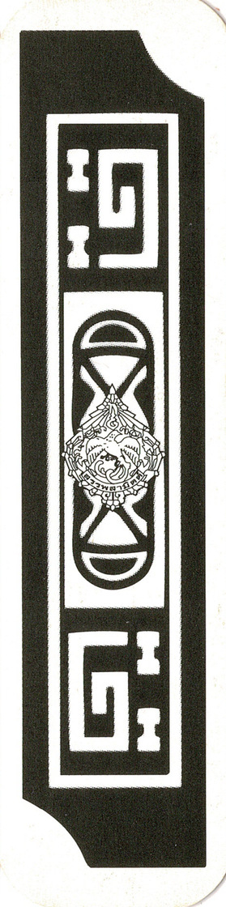
>
> ```yaml
> position: aside
> noborder: true
> size: small
> ```
>
> The mouse ace (<span lang="th">เอี่ยวหนู</span> <span lang="th-Latn">iao nu</span>), often used as a permanent joker.

For the joker game, there are multiple methods for determining which cards are jokers:

- Add specifically printed jokers to the deck, resulting in 124 or 128 cards (I have not found images of these).[@PaiPhong1967 50]
- Designating specific cards as permanent jokers — this is usually the ‘mouse ace’ (<span lang="th">เอี่ยวหนู</span> <span lang="th-Latn">iao nu</span>). Alternately, all aces might be specified as jokers.[@PaiPhong1967 50][@PaiPong 30]
    - In this case, one of the jokers may be specially marked (<span lang="th">อ้ายโม่ง</span> <span lang="th-Latn">ai mong</span>) and scores extra: doubling the payout if the winner has it in their hand.[@PaiPhong1967 52][@PaiPong 31]
- Giving everyone a single imaginary joker (<span lang="th">โจ๊กนึก</span> <span lang="th-Latn">jok nuek</span>). In this case players are dealt one card fewer, and are assumed to hold one wild card they can use.[@PaiPhong1967 52]

Two methods might be called ‘indicator’ methods:
- A card may be turned up from a secondary deck to determine the joker.
- After dealing, a card may be turned up from the _bottom_ of the stock to determine the joker (<span lang="th">โจ๊กเปิดก้น</span> <span lang="th-Latn">jok poet kon</span>); it is out of play.[@PaiPhong1967 50–1]

In these methods, there are three options for which cards become jokers:
- Only exact matches of the shown card are jokers.
- Only the other two cards of the same rank as the shown card are jokers, not the shown card.
- All cards of the same rank as the shown card are jokers.

These methods may be combined, for example specifying that the ‘mouse aces’ are jokers but also turning up bottom cards.[@PaiPong 30-1]

### Joker-specific rules

Discarding a joker is normally not allowed; but it may be permitted if the player is waiting for a jokerless win.[@PaiPhong1967 53–4]

A joker also cannot be used to form a pair for the purpose of claiming a <span lang="th-Latn">phong</span>.[@PaiPhong1967 53–4]

## Scoring and payment

Possible scoring hands are as follows; the actual scoring schedules follow as they differ based upon the method that is being used.[@PaiPong 33–50]

* **Fill the gap** (<span lang="th">กินช่อง</span> <span lang="th-Latn">kin chong</span>): three complete sets and an identical pair, winning on the exact matching card for that pair. The win is named for the number of <span lang="th-Latn">tong</span>s in the completed hand (at least one); four <span lang="th-Latn">tong</span>s is a special win.[@PaiPhong1967 36–8][@ThaiGambling 72]
  - **Four <span lang="th-Latn">tong</span>s** (<span lang="th">กินสี่ตอง</span> <span lang="th-Latn">kin si tong</span>): a hand consisting of only <span lang="th-Latn">tong</span>s. The hand is considered **concealed** (<span lang="th">สี่ตองมืด</span> <span lang="th-Latn">si tong muet</span>) if none of the first three was claimed by <span lang="th-Latn">phong</span>, or **open** (<span lang="th">สี่ตองผ่อง</span> <span lang="th-Latn">si tong phong</span>) if at least one was. The final card does not need to be self-drawn to be considered concealed.[@PaiPhong1967 39–40][@PaiPong 39][@ThaiGambling 73–4]
* **Smash** (<span lang="th">ทุบ</span> <span lang="th-Latn">thup</span>): three complete sets, at least two of them <span lang="th-Latn">tong</span>s, winning on a card to complete a head/group (completing a <span lang="th-Latn">tong</span> would give you 3- or 4-<span lang="th-Latn">tong</span>s instead).[@PaiPhong1967 42][@PaiPong 45]
* **Four heads** (<span lang="th">กินเศียร</span> <span lang="th-Latn">kin siian</span>): having three heads and completing the fourth with a winning card.[@PaiPhong1967 40–1][@PaiPong 34][@ThaiGambling 73]
* **Three <span lang="th-Latn">tong</span> and a head** (<span lang="th">3 ตองกินเศียร</span> <span lang="th-Latn">sam tong kin siian</span>) or ‘sour greens’ (<span lang="th">เขียวเปรี้ยว</span> <span lang="th-Latn">khiao priao</span>): have 3 tongs and win on a card that completes a final head.[@PaiPhong1967 59][@PaiPong 35–36][@ThaiGambling 75]
* **Three heads and a <span lang="th-Latn">tong</span>** (<span lang="th">3 เศียรกินตอง</span> <span lang="th-Latn">sam siian kin tong</span>) or ‘sweet greens’ (<span lang="th">เขียวหวาน</span> <span lang="th-Latn">khiao wan</span>): have 3 heads and win on a card that completes a final <span lang="th-Latn">tong</span>.[@PaiPhong1967 59][@PaiPong 35–36][@ThaiGambling 75]
* **Three <span lang="th-Latn">tong</span>s of one rank** (<span lang="th">สามตับ</span> <span lang="th-Latn">sam tap</span>): two <span lang="th-Latn">tong</span>s, one set of anything, completing a third <span lang="th-Latn">tong</span> to win.
   - **Three Reds** (<span lang="th">สามแดง</span> <span lang="th-Latn">sam daeng</span>) is a <span lang="th-Latn">tong</span> of each of the red-stamped cards (and must win by completing a <span lang="th-Latn">tong</span>). When playing with jokers, at least one ‘natural’ card is required in each red set.[@PaiPhong1967 59–60, 62–63][@PaiPong 42–43]
   - **Three <span lang="th-Latn">ngong</span>** (<span lang="th">สามง่อง</span> <span lang="th-Latn">sam ngong</span>) is a <span lang="th-Latn">tong</span> of each of <span lang="th-Latn">iao yao</span>, <span lang="th-Latn">song ongkhot</span>, and <span lang="th-Latn">sam nok</span>, plus another set. The winning card completes the third qualifying <span lang="th-Latn">tong</span>.[@PaiPhong1967 61–62]
* **Four of a face** (<span lang="th">กินสี่ตัว</span> <span lang="th-Latn">kin si tua</span>): two sets of anything and five cards of a single rank, three of them identical, winning on the fourth identical card. In the joker game, the count can go higher (5 of a face, possibly up to 12 of a face), and all cards of that face across the hand are counted, not just those in the final set. All jokers that are used *as that rank* are counted.[@PaiPhong1967 38, 58][@PaiPong 40–1][@ThaiGambling 73]
* **One family throughout** (<span lang="th">พวกเดียวกันทั้งมือ</span> <span lang="th-Latn">phuak diao kan thang mue</span>): 11 cards of the same rank, winning on a 12th.
   - **All <span lang="th-Latn">iao</span>** (<span lang="th">เอี่ยวทั้งมือ</span> <span lang="th-Latn">iao thang mue</span>): 11 ace/honour cards, winning on a 12th. Jokers may substitute in either hand.[@PaiPong 46–47][@ThaiGambling 74]

In the joker game the following hands are added, where **white** means ‘without jokers’:[@PaiPong 44–45][@PaiPhong1967 42, 54]

* **White gap** (<span lang="th">ช่องขาว</span> <span lang="th-Latn">chong khao</span>): the same as **fill the gap** but with no jokers in the hand.
* **White smash** (<span lang="th">ทุบขาว</span> <span lang="th-Latn">thup khao</span>): the same as **smash** but with no jokers in the hand.

Both sample hands use a head of sevens as their fourth set.

**Three reds**

> [!multi-equal]
>
> > [!figure]
> >
> > 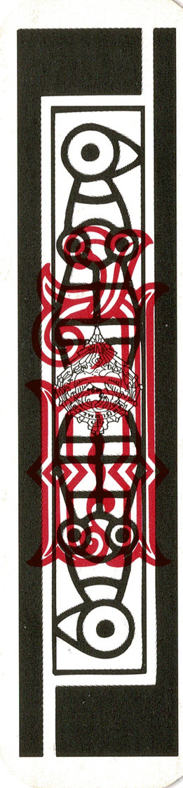
> > 
> > 
> >
> > ```yaml
> > noborder: true
> > cram: true
> > size: "small"
> > ```
> >
> > Red nine
>
> > [!figure]
> >
> > 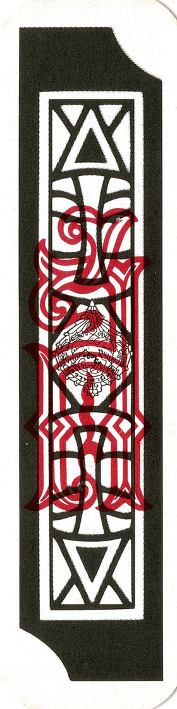
> > 
> > 
> >
> > ```yaml
> > noborder: true
> > cram: true
> > size: "small"
> > ```
> >
> > Red lady ace
>
> > [!figure]
> >
> > 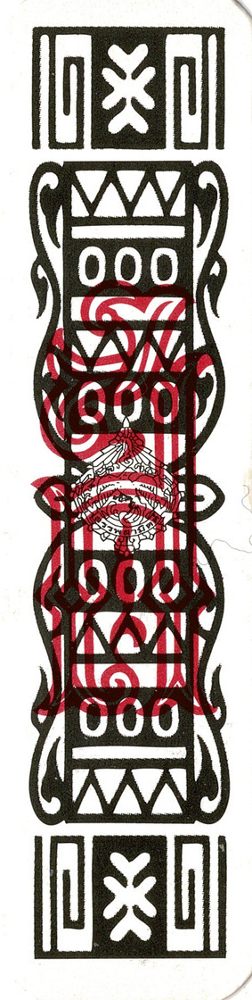
> > 
> > 
> >
> > ```yaml
> > noborder: true
> > cram: true
> > size: "small"
> > ```
> >
> > Red king ace
>
> > [!figure]
> >
> > 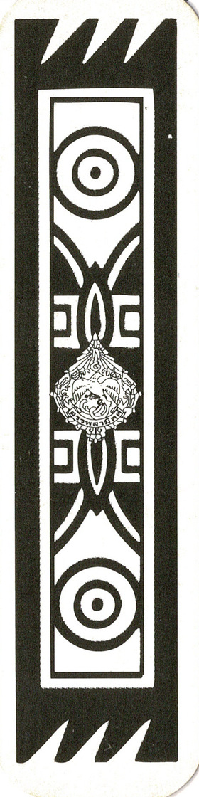
> > 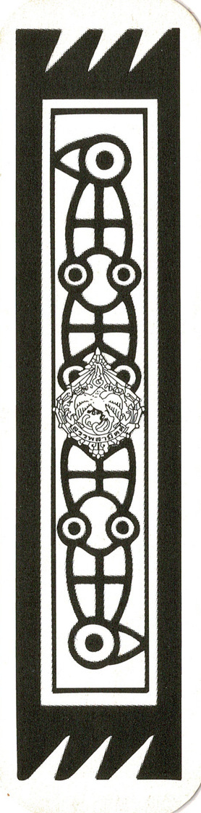
> > 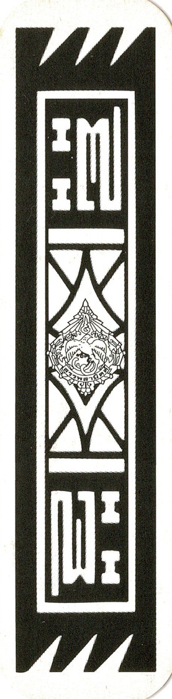
> >
> > ```yaml
> > noborder: true
> > cram: true
> > size: "small"
> > ```
> >
> > Head of sevens

**Three <span lang="th-Latn">ngong</span>**

> [!multi-equal]
>
> > [!figure]
> >
> > 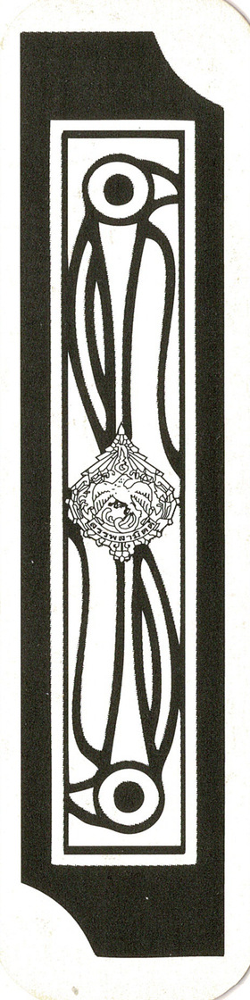
> > 
> > 
> >
> > ```yaml
> > noborder: true
> > cram: true
> > size: "small"
> > ```
> >
> > Long ace (<span lang="th-Latn">iao yao</span>)
>
> > [!figure]
> >
> > 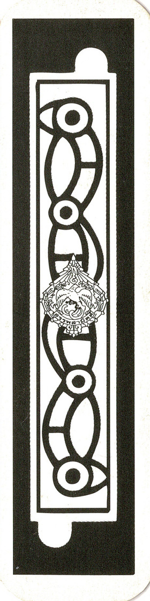
> > 
> > 
> >
> > ```yaml
> > noborder: true
> > cram: true
> > size: "small"
> > ```
> >
> > <span lang="th-Latn">Song Ongkhot</span> (2 of Strings)
>
> > [!figure]
> >
> > 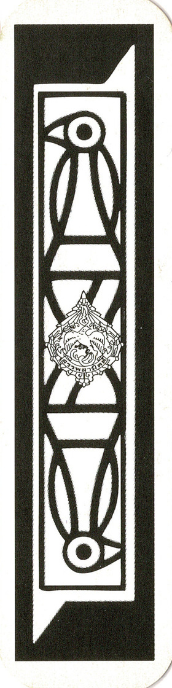
> > 
> > 
> >
> > ```yaml
> > noborder: true
> > cram: true
> > size: "small"
> > ```
> >
> > Three birds (<span lang="th-Latn">sam nok</span>)
>
> > [!figure]
> >
> > 
> > 
> > 
> >
> > ```yaml
> > noborder: true
> > cram: true
> > size: "small"
> > ```
> >
> > Head of sevens

[^tap]: <span lang="th">ตับ</span> can refer to things arranged in a row, though its intended sense in this name is uncertain. See the [Office of the Royal Society](http://legacy.orst.go.th/?knowledges=%E0%B8%95%E0%B8%B1%E0%B8%9A-%E0%B9%92-%E0%B9%92%E0%B9%93-%E0%B9%80%E0%B8%A1%E0%B8%A9%E0%B8%B2%E0%B8%A2%E0%B8%99-%E0%B9%92%E0%B9%95%E0%B9%95%E0%B9%95).

Other scoring features are:

- **Self-draw** (<span lang="th">ถลก</span>): to draw your own winning card

For the ‘prediction’ scores, a the start of the hand, before dealing, each player chooses a card from their additional set and keeps it face down in front of them.[@PaiPong 28–9] If they complete their win with a card that matches they score extra:

* **Exact guess** (<span lang="th">เก็งตรง</span>): to win with a card exactly matching the prediction
* **Side guess** (<span lang="th">เก็งข้าง</span>): to win with a card of the same rank as the predicted card
* **House-card win** (<span lang="th">กินตัวหิ้ง</span> <span lang="th-Latn">kin tua hing</span>): similarly, a win on a card matching one secretly chosen by the house before play.[@PaiPhong1967 43]

### Fixed payments

A sample fixed-payment scheme is as follows, in terms of Thai Baht (฿).[@PaiPong 48–50] Note that the ordinary Fill-the-gap and Smash wins are unpriced here. I suspect that they should be included as ฿2.

<table>
<thead>
<tr>
<th scope="col">Win</th>
<th scope="col">Payment</th>
</tr>
</thead>
<tbody>
<tr>
<th>Self-draw</th>
<td rowspan="6">฿4</td>
</tr>
<tr>
<th>Four heads</th>
</tr>
<tr>
<th>Sour greens</th>
</tr>
<tr>
<th>Sweet greens</th>
</tr>
<tr>
<th>Side prediction</th>
</tr>
<tr>
<th>Four of a face</th>
</tr>
<tr>
<th>Exact prediction</th>
<td rowspan="3">฿8</td>
</tr>
<tr>
<th>Open four <span lang="th-Latn">tong</span>s</th>
</tr>
<tr>
<th>Five of a face</th>
</tr>
<tr>
<th>Six of a face</th>
<td rowspan="2">฿12</td>
</tr>
<tr>
<th>Three <span lang="th-Latn">tong</span>s of one rank</th>
</tr>
<tr>
<th>Concealed four <span lang="th-Latn">tong</span>s</th>
<td rowspan="2">฿16</td>
</tr>
<tr>
<th>White smash</th>
</tr>
<tr>
<th>Three reds</th>
<td rowspan="2">฿40</td>
</tr>
<tr>
<th>White gap</th>
</tr>
<tr>
<th>All <span lang="th-Latn">iao</span></th>
<td>฿20 plus ฿4 per card of the winning face</td>
</tr>
<tr>
<th>One family throughout</th>
<td>฿30 plus ฿4 per card of the winning face</td>
</tr>
</tbody>
</table>

### Scoring schedules

Another way to score is in terms of <span lang="th-Latn">lom</span> (<span lang="th">ล้ม</span>). Before play, a set value is agreed for a <span lang="th-Latn">lom</span>, e.g. ฿2 per <span lang="th-Latn">lom</span>. Ordinary hands (fill-the-gap, self-draw, etc) are paid at an agreed separate lower rate. Special hands are paid for their total <span lang="th-Latn">lom</span> value, according to the agreed-upon schedule.

Two versions are shown below; both assume the use of jokers.[@PaiPhong1967 56–7, 63–4] A **white win** (<span lang="th">กินขาว</span> <span lang="th-Latn">kin khao</span>) is any win without jokers; these schedules do not price white gap and white smash separately.[@PaiPhong1967 43, 54] The values of multiple scoring features are added together.

**First schedule**

| <span lang="th-Latn">Lom</span> | Winning features |
| ---: | --- |
| 1 | Self-drawn four of a face; five of a face; open four <span lang="th-Latn">tong</span>s; four heads; sour greens; sweet greens; three <span lang="th-Latn">tong</span>s of one rank; prediction win |
| 2 | Six of a face; house-card win; white win; all <span lang="th-Latn">iao</span> |
| 3 | Seven of a face; one family throughout; three reds; three <span lang="th-Latn">ngong</span>; concealed four <span lang="th-Latn">tong</span>s |
| 4 | Eight+ of a face (add one more for each additional face up to 12) |

**Second schedule**

| <span lang="th-Latn">Lom</span> | Winning features |
| ---: | --- |
| 1 | Four of a face; four heads; sour greens; sweet greens |
| 2 | Open four <span lang="th-Latn">tong</span>s; five of a face; prediction win; three <span lang="th-Latn">tong</span>s of one rank; white win |
| 3 | Six of a face; house-card win; all <span lang="th-Latn">iao</span> |
| 4 | Seven of a face; one family throughout; three reds; three <span lang="th-Latn">ngong</span>; concealed four <span lang="th-Latn">tong</span>s; four <span lang="th-Latn">tong</span>s all of the ‘person’ type; four <span lang="th-Latn">tong</span>s all of the ‘eye’ type |
| 5 | Eight+ of a face (add one more for each additional face up to 12) |

## Pong

The game is also played in Malaysia under the name <span class="noun aka" lang="ms">Pong</span>. In @GamblingGamesOfMalaya [p. 137–8] it is described as being played with Mahjong tiles, but I think it is probably also played with [Ceki cards](articles/cards/ceki/ceki.md). According to the book, it is played in the Malaysian state of [Kelantan](https://en.wikipedia.org/wiki/Kelantan), which is adjacent to Thailand. The game as reported there is only played with four players.

To play with Mahjong tiles, use 120 tiles: all of the suited (circle, bamboo, character) tiles, as well as the honour (“dragon”) tiles, but no winds or flowers.

To deal, build them into four walls of 30 tiles (15 long × 2 high), then draw the tiles one at a time from the wall in a clockwise direction, as in Mahjong.

Play and win as in the Thai game.

A set of three identical cards or tiles is again called a <span lang="ms">tong</span>, a set of three mixed tiles is called a <span lang="ms">tong serong</span> (“crooked <span lang="ms">tong</span>”).

The winning player scores 2 points + 1 point for each pure <span lang="ms">tong</span> they have in their hand. Thus, the scores range from only 2 points for a hand containing four <span lang="ms">tong serong</span>, up to 6 points for a hand containing four <span lang="ms">tong</span>. Payment may be collected from the other players on the basis of some fixed amount per point.
